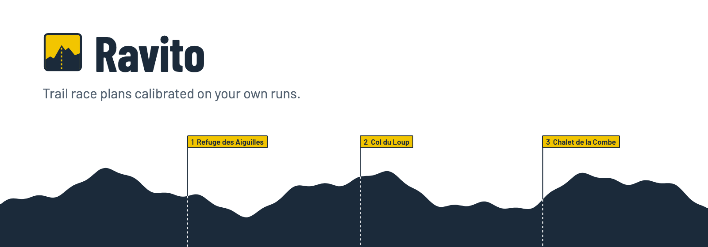
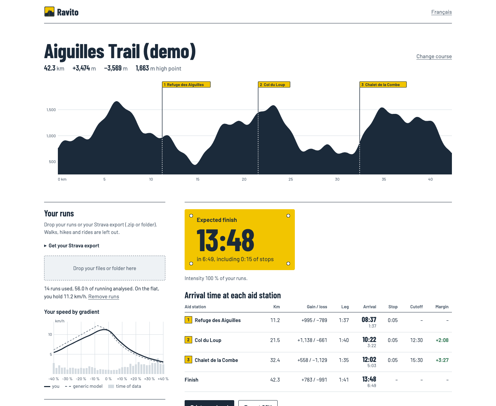

<p align="center">
  <picture>
    <source media="(prefers-color-scheme: dark)" srcset=".github/assets/banner-dark.png">
    
  </picture>
</p>

<p align="center">
  <a href="https://mat-d3v.github.io/ravito/?lang=fr"><b>Ouvrir Ravito</b></a>
  &nbsp;&nbsp;|&nbsp;&nbsp;
  <a href="https://mat-d3v.github.io/ravito/?demo&lang=fr">Voir la démo</a>
  &nbsp;&nbsp;|&nbsp;&nbsp;
  <a href="README.md">Read in English</a>
</p>

Dépose le GPX de ta course et tes sorties passées : Ravito te donne ton heure de passage à chaque ravito, ta marge sur chaque barrière horaire, et un bracelet d'allure à imprimer.

Tout tourne dans ton navigateur. Pas de compte, pas de serveur, pas de pistage : tes fichiers ne quittent jamais ton ordinateur.

<p align="center">
  <picture>
    <source media="(prefers-color-scheme: dark)" srcset=".github/assets/screenshot-dark.png">
    
  </picture>
</p>

## Pourquoi un planificateur de plus ?

Les fabricants de montres (Garmin PacePro, COROS Pace Strategy) et quelques sites découpent déjà un parcours selon la pente, parfois en tenant compte de ta forme. Ravito se distingue sur trois points :

1. **Un calibrage transparent, pente par pente.** Ravito montre à quelle vitesse *tu* vas réellement à −20 %, 0 % ou +25 % d'après tes sorties, à côté du modèle générique, avec le volume de données derrière chaque point. Pas de boîte noire.
2. **Pensé pour les longues distances.** Le plan tient compte de la fatigue au fil des heures et des arrêts aux ravitos, pour des marges réalistes sur les barrières.
3. **Libre, privé, toutes marques.** Logiciel libre, une simple page web, compatible avec les fichiers de n'importe quelle montre.

## Fonctionnalités

- Import du parcours : GPX (ravitos lus dans ses waypoints), TCX, FIT et versions `.gz`.
- Import de l'historique : fichiers à l'unité ou **ton export Strava complet** (`.zip` ou dossier décompressé). Grâce à `activities.csv`, la marche, la rando et le vélo sont écartés automatiquement.
- Altitude fiabilisée : rééchantillonnage à pas fixe, lissage et seuil de 3 m, pour que le bruit GPS ne gonfle ni le D+ ni les pentes.
- Deux modes : **prédire mon temps** (curseur d'intensité) ou **viser un temps** (Ravito trouve l'effort correspondant).
- Ravitos : temps d'arrêt et barrières en heure d'horloge (courses sur plusieurs jours gérées) ; la marge passe en rouge si tu es hors délai.
- Profil interactif, tableau par ravito, temps kilomètre par kilomètre, export CSV et **bracelet à imprimer**.
- Français et anglais, thèmes clair et sombre.

## Récupérer ton export Strava

1. Sur strava.com, ouvre [Paramètres, puis Mon compte](https://www.strava.com/account).
2. Sous « Télécharger ton compte », clique sur Commencer, puis demande le téléchargement.
3. Strava t'envoie un e-mail avec l'archive, souvent en quelques heures.
4. Dépose le `.zip` dans Ravito tel quel.

Plus de détails dans [l'aide de Strava](https://support.strava.com/en-us/articles/15401919-how-do-i-export-my-strava-data). Les fichiers de Garmin Connect, COROS ou Suunto marchent aussi : exporte-les en GPX, TCX ou FIT.

## Comment marche le modèle

1. **Parcours** : la trace est rééchantillonnée tous les 25 m et l'altitude lissée sur 150 m avant le calcul des pentes.
2. **Courbe générique** : la vitesse par rapport au plat suit le coût énergétique de la course en pente (Minetti et al., 2002), adouci pour la marche dans les fortes montées. En descente, le gain est plafonné à environ +10 % vers −8 %, puis la vitesse baisse dans les pentes raides et techniques.
3. **Ta courbe** : chaque sortie est découpée en morceaux de 100 m, pauses exclues. Les marches étiquetées « course » sur Strava sont écartées : leur vitesse médiane sur terrain roulant est sous 6,5 km/h. Les sorties récentes comptent davantage (demi-vie de 60 jours), pour suivre ta forme du moment. Pour chaque classe de pente de 2 %, ta vitesse médiane est mélangée à la courbe générique selon le volume de données. En montée, la vitesse ne peut que baisser quand la pente augmente.
4. **Simulation** : tous les 25 m, vitesse = ta courbe × intensité × facteur de fatigue. La fatigue s'applique après 1 h 30 (tes sorties l'incluent déjà) et augmente avec le temps écoulé ; le curseur « baisse de régime avec la fatigue » règle sa vitesse.

Le moteur (`src/engine/`) est en TypeScript pur, sans DOM, et couvert par des tests : il retrouve la courbe d'un coureur connu à partir de sorties synthétiques, ignore les pauses, écarte le vélo, atteint un temps visé et place correctement les ravitos.

**Quelle précision ?** `npm run backtest -- "<dossier de l'export Strava>"` prédit chacune de tes sorties à partir des seules sorties précédentes et mesure l'écart. Sur un historique test de 99 sorties, l'erreur médiane sur le temps de déplacement est de 4,3 % (moyenne 5,5 %). L'essentiel de cette erreur vient des sorties faites à des intensités différentes, qu'aucun modèle ne peut deviner.

## Lancer en local

```bash
npm install
npm run dev     # http://localhost:5173/ravito/
npm test        # tests du moteur
npm run build   # site statique dans dist/
```

Ajoute `?demo` à l'adresse pour charger la démo, et `?lang=fr` ou `?lang=en` pour choisir la langue. Le parcours et le coureur de démo sont entièrement synthétiques : aucune trace de course réelle n'est redistribuée.

## Feuille de route

- Analyse d'après-course : comparer le plan et le réel, tronçon par tronçon, et affiner ta courbe.
- Calculer la baisse de régime à partir de tes plus longues sorties.
- Ralentissement de nuit et en altitude.
- Export du parcours vers la montre avec alertes aux ravitos.
- Vue carte.

## Licence

[MIT](LICENSE)
