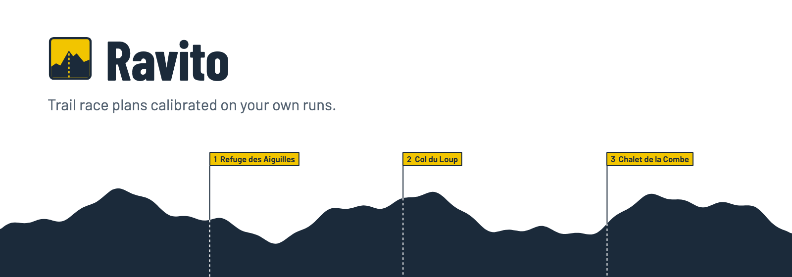
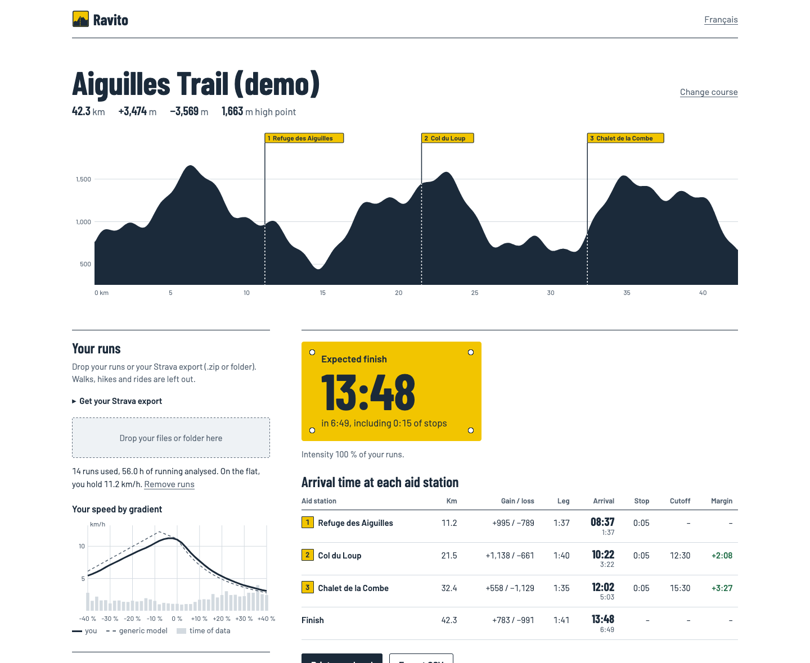

<p align="center">
  <picture>
    <source media="(prefers-color-scheme: dark)" srcset=".github/assets/banner-dark.png">
    
  </picture>
</p>

<p align="center">
  <a href="https://mat-d3v.github.io/ravito/"><b>Open Ravito</b></a>
  &nbsp;&nbsp;|&nbsp;&nbsp;
  <a href="https://mat-d3v.github.io/ravito/?demo">See the demo</a>
  &nbsp;&nbsp;|&nbsp;&nbsp;
  <a href="README.fr.md">Lire en français</a>
</p>

Drop the race GPX and your past runs. Ravito tells you when you'll reach each aid station, how much margin you have on every cutoff, and prints a pace band for your wrist.

Everything runs in your browser. No account, no server, no tracking: your files never leave your computer.

<p align="center">
  <picture>
    <source media="(prefers-color-scheme: dark)" srcset=".github/assets/screenshot-dark.png">
    
  </picture>
</p>

## Why another planner?

Watch makers (Garmin PacePro, COROS Pace Strategy) and a few web tools already split a course by gradient, some using your fitness data. Ravito differs in three ways:

1. **A transparent, per-gradient calibration.** Ravito shows how fast *you* actually go at −20 %, 0 % or +25 % from your own runs, next to the generic model, with the amount of data behind each point. No black box.
2. **Built for long races.** The plan accounts for fatigue after hours on your feet, and for stops at aid stations, so cutoff margins are realistic.
3. **Open, private, brand-agnostic.** Free software, a single static page, works with files from any watch.

## Features

- Course import: GPX (with aid stations read from its waypoints), TCX, FIT, and `.gz` versions.
- History import: individual files or **your whole Strava export** (`.zip` or unzipped folder). With `activities.csv`, walks, hikes and rides are left out automatically.
- Robust elevation handling: fixed-step resampling, smoothing and a 3 m hysteresis threshold, so noisy GPS altitude doesn't inflate the gain or the grades.
- Two modes: **predict my time** (intensity slider) or **aim for a time** (Ravito finds the matching effort).
- Aid stations: stop time and clock cutoffs (multi-day races supported); the margin turns red when you're too late.
- Interactive elevation profile, per-section table, kilometre splits, CSV export and a **printable pace band**.
- English and French, light and dark themes.

## Getting your Strava export

1. On strava.com, open [Settings, then My Account](https://www.strava.com/settings/account).
2. Under "Download your account", click Get Started, then request the download.
3. Strava emails you the archive, usually within a few hours.
4. Drop the `.zip` into Ravito as it is.

More in [Strava's help](https://support.strava.com/en-us/articles/15401919-how-do-i-export-my-strava-data). Files from Garmin Connect, COROS or Suunto work too: export them as GPX, TCX or FIT.

## How the model works

1. **Course**: the track is resampled every 25 m and the elevation smoothed over 150 m before grades are computed.
2. **Generic curve**: speed relative to flat ground follows the energy cost of running on slopes (Minetti et al., 2002), softened for hiking on steep climbs. On descents, the gain is capped at about +10 % around −8 %, then speed drops on steep, technical ground.
3. **Your curve**: each run is cut into 100 m pieces (stops removed). For each 2 % gradient class, your median speed is blended with the generic curve according to how many minutes of data you have. On climbs, speed is forced to keep decreasing as the slope steepens.
4. **Race simulation**: every 25 m, speed = your curve × intensity × fatigue factor. Fatigue kicks in after 1.5 h (training runs already include it) and grows with elapsed time; the "slowdown with fatigue" slider sets how fast.

The engine (`src/engine/`) is pure TypeScript with no DOM, covered by unit tests: recovering a known runner's curve from synthetic runs, ignoring pauses, rejecting bike rides, solving a target time, aid-station timing.

## Running it locally

```bash
npm install
npm run dev     # http://localhost:5173/ravito/
npm test        # engine tests
npm run build   # static site in dist/
```

Add `?demo` to the address to load the demo course, and `?lang=fr` or `?lang=en` to pick the language. The demo course and demo runner are fully synthetic; no real race track is redistributed.

## Roadmap

- Post-race analysis: compare plan vs. actual, section by section, and refine your curve.
- Fit the fatigue parameter from your longest runs.
- Night and altitude slowdowns.
- Course export to watches with aid-station alerts.
- Map view.

## License

[MIT](LICENSE)
